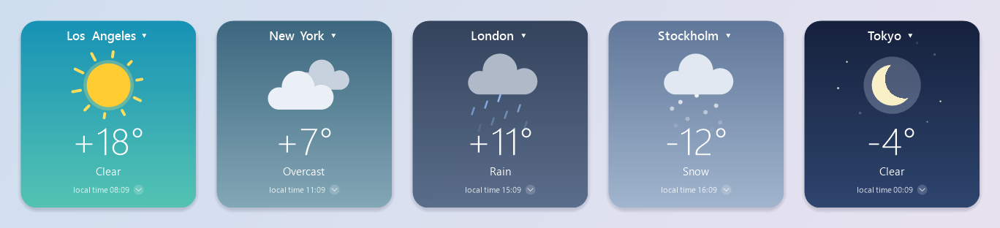
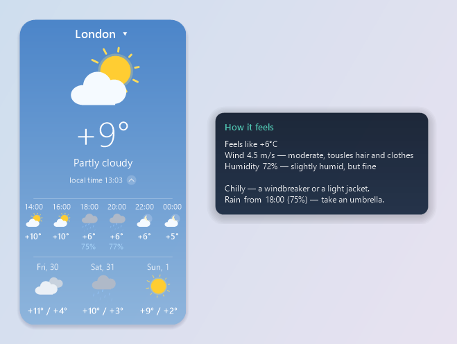

**English** · [Русский](README.md)

# Weather — a desktop widget for Windows

A lightweight weather widget with vector animation, "what to wear" advice, and hourly and 3-day forecasts.
A single `.exe` with no installation: runs on any Windows 10/11 using the built-in .NET Framework.



## Installation

1. Download `WeatherWidget-<version>.zip` from the [latest release](../../releases/latest).
2. Unzip it to any folder and run `WeatherWidget.exe` — no installation needed.
3. Find your city in the search window that appears.

**If Windows warns you.** The program isn't code-signed (a certificate costs money), so on first launch Windows
may show "Windows protected your PC". Click **"More info"** → **"Run anyway"**.
The source code is open — you can build the exe yourself (see "Building").

## Features

- **Animated weather** — the sun with rotating rays, drifting clouds, rain, snow;
  at night — the moon and twinkling stars. The background color changes with the weather.
- **"Feels like" and what to wear** — hover over the temperature: the feels-like temperature,
  wind and humidity in plain words, plus clothing advice ("a T-shirt is fine", "a hoodie", "a warm jacket"…).
- **Sunrise, sunset and UV index** — in the same tooltip: "Sunrise 07:29, sunset 16:56", after sunset — tomorrow's;
  when the sun is strong — "UV index up to 8 (very high) — sunscreen, a hat and shade at midday".
- **Umbrella by forecast, not by window** — the advice checks precipitation 12 hours ahead:
  "Rain from 17:00 (80%) — take an umbrella", and if it's already raining — "rain until 16:00".
- **Hourly and 3-day forecast** — expands with a small button next to the time:
  half a day in 2-hour steps with precipitation chance, plus the next 3 days.
- **Any city in the world** — on first launch the widget asks you to pick a city and opens the search.
  Search forgives typos: for "Sidney" it suggests Sydney, Australia first, for "Barselona" — Barcelona
  (using a built-in list of ~2800 large cities, works offline too).
  Chosen cities are remembered in the menu (up to 10, extra ones removed with a cross) — no preset list.
- **Dynamic weather** — 100 major world cities in turn every 45 seconds, in random order,
  with a smooth transition; the city's local time is shown.
- **Transparent background** — a slider in the menu: the card background goes from opaque to fully transparent,
  while text and animation stay crisp.
- **Russian and English** — the default language follows Windows; switch it in the "Язык / Language" menu
  instantly, without a restart: texts, advice, weekdays, city search and the "dynamic weather" cities.
- **°C or °F** — the "Units" menu: °C and m/s or °F and mph; by default — as usual in the country from Windows settings.
- **Neat window** — smooth edges, scale from 60 to 250% by dragging any corner,
  tooltips that don't activate the window, position and all settings remembered.
- **Works when the connection fails** — if the main source is unavailable, the weather comes from the backup
  (MET Norway); without internet the widget shows the latest data marked "offline · data from 25 min ago"
  and refreshes by itself as soon as the network is back.
- **One-click updates** — once a day (or via "Check for updates" in the menu) it checks the latest release
  on GitHub; if there's a new one, "Update to version …" appears at the top of the menu. A click downloads the release
  archive, verifies its SHA-256 checksum and the program version, replaces the exe and restarts the widget —
  settings are kept. Nothing is downloaded or installed without that click.
- **Crisp at any display scale** — 125%, 150% and different scales on two monitors:
  the widget draws in real screen pixels instead of being stretched by Windows.
- **Always easy to find** — a tray icon: a click brings the widget to the front, its menu has
  "Reset position" (back to the top-right corner) and "Exit". Launching the exe again
  doesn't open a second widget — it shows the one already running.
- **Fresh weather after sleep** — when the laptop wakes up, the weather refreshes right away.
- **Light on the system** — ~1–2% of one CPU core, ~45 MB of memory.



## Controls

| Action | What happens |
|---|---|
| Click the city name | city panel: search and your cities (click again, Esc or click outside — close; arrows and Enter — pick with the keyboard) |
| Hover the city name | country |
| Hover the temperature | feels like, wind, humidity, what to wear, sunrise and sunset, UV index |
| ⌄ button next to the time | expand / collapse the hourly and 3-day forecast |
| Double-click the card | turn "Dynamic weather" on / off |
| Drag the card | move the widget |
| Card corner | resize |
| Right click | menu: choose city, dynamic weather, refresh, transparency, always on top, start with Windows, language, units, check for updates, about, exit |
| Tray icon | click — show the widget; right click — show, reset position, exit |
| Transparency… | background transparency slider; mouse wheel and arrows — 5% step, Esc or click outside — close |

## Building

All you need is Windows with .NET Framework 4.x (included in Windows 10/11) — nothing to install.

```bat
build.bat                 :: build bin\WeatherWidget.exe
test.bat                  :: build and run the tests
tools\make-assets.bat     :: regenerate the icon and README images (Russian and English)
tools\make-release.bat 1.3.2   :: build, test and pack dist\WeatherWidget-1.3.2.zip for a release
```

The code is written in C# 5 — the version understood by the `csc.exe` compiler built into .NET Framework.
Code comments are in Russian.

## Project structure

```
src/
  Program.cs                 entry point, version, single instance, error log
  Model/                     data: city, weather, built-in city lists
  Logic/                     logic without UI — covered by tests
    WeatherCodes.cs            WMO weather codes → sky type and description
    Advice.cs                  feels like, wind, humidity, what to wear, upcoming precipitation, sun and UV
    CityRotation.cs            order of "dynamic weather" cities
    CustomCities.cs            your cities
    Lang.cs                    UI language: texts in pairs L.T("рус", "eng")
    Units.cs                   units: °C and m/s or °F and mph
    CityNames.cs               your cities' names in another language
    CitySuggest.cs             typo suggestions: Damerau–Levenshtein distance
    CitySearch.cs              city search: server results + typo suggestions
  Data/
    WeatherService.cs          where to get weather: Open-Meteo → MET Norway → cache
    OpenMeteo.cs               main source: weather and city search
    MetNo.cs                   backup source MET Norway
    WeatherCache.cs            latest data for each city
    KnownCities.cs             built-in list of large cities (assets\cities.txt)
    Http.cs                    HTTPS downloads
    SafeFile.cs                writing files without leaving a "half" file
    Settings.cs                settings (text file)
    AutoStart.cs               starting with Windows
    ErrorLog.cs                error log error.log
  UI/
    WeatherForm.cs             window: state, menu, loading weather
    RefreshSchedule.cs         when to refresh: timers, network, wake from sleep
    AppUpdater.cs              checking for and installing new versions
    WeatherForm.Window.cs      size, dragging, mouse, tooltips
    WeatherForm.Rendering.cs   drawing the card and animation
    WeatherIcons.cs            vector weather icons
    LayeredSurface.cs          window with per-pixel transparency
    CityPicker.cs              city panel: search, your cities, keyboard and mouse
    CityPicker.Rendering.cs    drawing the city panel
    OpacityPanel.cs            transparency slider panel
    Dpi.cs                     display scale (DPI) of each monitor
    MenuRenderer.cs            menus in the widget style (right click, tray icon)
    TipWindow.cs, Theme.cs, NativeMethods.cs
tests/                       tests and sample server responses
tools/                       icon and README image generation, release packing
.github/workflows/           CI: tests on every push, release on a v<version> tag
assets/app.ico               program icon
assets/app.manifest          exe manifest: DPI-aware (PerMonitorV2)
assets/cities.txt            ~2800 large cities in two languages — embedded into the exe
```

## How it works

- **Transparency.** The window is a layered window: every frame is drawn into a 32-bit buffer with an alpha channel
  and handed to Windows via `UpdateLayeredWindow`. That's why the edges are smooth and the area outside the card
  is transparent and lets clicks through. Even at 100% the card background keeps a minimal alpha,
  so the card can still be dragged and right-clicked.
- **Display scale.** The manifest marks the program as PerMonitorV2: Windows doesn't stretch its windows,
  the widget multiplies the base layout (width 240) by the monitor's scale itself. When moved to a monitor
  with a different scale (`WM_DPICHANGED`) the card keeps the same visible size;
  the size saved to settings excludes the display scale.
- **Smoothness.** All animations are computed from real time, not timer ticks.
  At rest — 25 fps, during transitions — ~60. The window doesn't resize when the forecast expands —
  the card is simply drawn further.
- **Data.** Weather refreshes every 15 minutes. Source order:
  1. **Open-Meteo** — two attempts;
  2. **MET Norway** — if Open-Meteo didn't answer. Its response has no feels-like temperature or time zone:
     feels-like is calculated with the Steadman formula (as Open-Meteo does), the time zone is the last known one
     for the city, otherwise estimated from longitude;
  3. **cache** — the latest data for the city, no older than 3 days, marked "offline · data from N min ago".

  Without a connection the widget retries every 2 minutes, and immediately when Windows reports the network is back.
  On startup the cache is shown instantly while fresh data loads.
- **Language.** Russian or English; by default the Windows UI language (Russian for Russian Windows,
  English for everything else). The choice from the menu is saved in the settings (`lang=ru|en`).
  Your saved cities are translated in the background when the language changes: the city is looked up
  in the language of its name, then its name in the new language is fetched by GeoNames id
  (so "Омск" becomes "Omsk", not "Omskiy"). Offline, names stay as they are and get translated
  on the next launch or when the network is back.
- **Units.** Weather is stored and advice is computed in °C and m/s; °F and mph are converted only for display.
  °F is the default for the US, Liberia and Myanmar (country from Windows settings); the menu choice is saved (`units=…`).
- **Settings** live in `%APPDATA%\WeatherWidget\settings.txt` (`key=value` format),
  the weather cache — in `%APPDATA%\WeatherWidget\cache\`. If something goes wrong, the error is written
  to `%APPDATA%\WeatherWidget\error.log` (the widget keeps running). The same file gets a one-line note
  when a weather source doesn't answer and why, e.g.
  `Open-Meteo, Omsk: WebException: (429) Too Many Requests`; the same error at most once every 10 minutes.
  Autostart is an entry in `HKCU\Software\Microsoft\Windows\CurrentVersion\Run`, no admin rights needed.

## Data sources

- [Open-Meteo](https://open-meteo.com) — main weather source and city search.
  Free and keyless for non-commercial use.
- [MET Norway](https://api.met.no) (Norwegian Meteorological Institute) — backup weather source.
  Free, keyless; the app identifies itself in the User-Agent header as the
  [terms](https://api.met.no/doc/TermsOfService) require, and only calls it when Open-Meteo is unavailable.
- [GeoNames](https://www.geonames.org) — city names and coordinates in search (via Open-Meteo)
  and the built-in list of large cities for typo suggestions. The list is regenerated with
  `bin\WeatherWidget.Tools.exe cities cities15000.txt countryInfo.txt assets\cities.txt`
  from the [GeoNames dumps](https://download.geonames.org/export/dump/); Russian names come from Open-Meteo.

All this data is distributed under the
[CC BY 4.0](https://creativecommons.org/licenses/by/4.0/) license.

## Possible improvements

- Backup city search: currently search works only through Open-Meteo.
- More backup sources with a free key (sign-up, limits): OpenWeatherMap, WeatherAPI.com.

## License

[MIT](LICENSE) — the code may be freely used, modified and distributed, keeping the author attribution.
