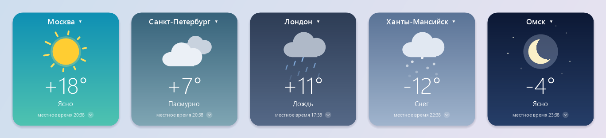
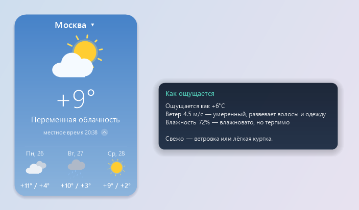

[English](README.en.md) · **Русский**

# Погода — виджет для рабочего стола Windows

Лёгкий виджет погоды с векторной анимацией, советом «что надеть» и прогнозом по часам и на 3 дня.
Один `.exe` без установки: работает на любой Windows 10/11 на встроенном .NET Framework.



## Возможности

- **Анимированная погода** — солнце с вращающимися лучами, плывущие облака, дождь, снег;
  ночью — луна и мерцающие звёзды. Цвет фона меняется вместе с погодой.
- **«Как ощущается» и что надеть** — подсказка при наведении на температуру: ощущаемая температура,
  ветер и влажность простыми словами и совет по одежде («можно в футболке», «худи», «тёплая куртка»…).
- **Зонт — по прогнозу, а не по окну** — совет смотрит осадки на 12 часов вперёд:
  «С 17:00 дождь (80%) — возьмите зонт», а если дождь уже идёт — «дождь до 16:00».
- **Прогноз по часам и на 3 дня** — раскрывается маленькой кнопкой справа от времени:
  полсуток через 2 часа с вероятностью осадков и 3 следующих дня.
- **Любой город мира** — при первом запуске виджет сам предлагает выбрать город и открывает поиск.
  Поиск прощает опечатки: на «Sidney» первым предложит Сидней в Австралии, на «Barselona» — Барселону
  (по встроенному списку ~2800 крупных городов, работает и без интернета).
  Выбранные города запоминаются в меню (до 10, лишние удаляются крестиком) — без предустановленного списка.
- **Динамическая погода** — 35 городов мира по кругу каждые 45 секунд, в случайном порядке,
  с плавной сменой; показывается местное время города.
- **Прозрачный фон** — ползунок в меню: фон карточки от непрозрачного до полностью прозрачного,
  текст и анимация при этом остаются чёткими.
- **Русский и английский** — язык по умолчанию берётся из Windows, переключается в меню «Язык / Language»
  сразу, без перезапуска: тексты, советы, дни недели, поиск городов и города «динамической погоды».
- **Аккуратное окно** — сглаженные края, масштаб от 60 до 250 % за любой угол,
  подсказки без активации окна, запоминание положения и всех настроек.
- **Работает при сбоях связи** — если основной источник недоступен, погода берётся из резервного
  (MET Norway); без интернета виджет показывает последние данные с пометкой «нет связи · данные 25 мин назад»
  и обновляется сам, как только сеть вернётся.
- **Не грузит систему** — ~1–2 % одного ядра процессора, ~45 МБ памяти.



## Управление

| Действие | Что происходит |
|---|---|
| Клик по названию города | панель выбора города: поиск и свои города (повторный клик, Esc или клик мимо — закрыть; стрелки и Enter — выбор с клавиатуры) |
| Наведение на название города | страна |
| Наведение на температуру | как ощущается, ветер, влажность, что надеть |
| Кнопка ⌄ справа от времени | раскрыть / свернуть прогноз по часам и на 3 дня |
| Двойной клик по карточке | включить / выключить «Динамическую погоду» |
| Перетаскивание карточки | переместить виджет |
| Угол карточки | изменить размер |
| Правая кнопка | меню: выбрать город, динамическая погода, обновить, прозрачность, поверх окон, автозапуск, язык, о программе, выход |
| Прозрачность… | ползунок прозрачности фона; колёсико и стрелки — шаг 5 %, Esc или клик мимо — закрыть |

## Сборка

Нужен только Windows с .NET Framework 4.x (есть в Windows 10/11) — ничего устанавливать не нужно.

```bat
build.bat                 :: собрать bin\WeatherWidget.exe
test.bat                  :: собрать и прогнать автотесты
tools\make-assets.bat     :: пересоздать иконку и картинки для README (русские и английские)
```

Код написан на C# 5 — эту версию понимает компилятор `csc.exe`, встроенный в .NET Framework.

## Структура проекта

```
src/
  Program.cs                 точка входа, версия
  Model/                     данные: город, погода, встроенные списки городов
  Logic/                     логика без интерфейса — покрыта тестами
    WeatherCodes.cs            коды погоды WMO → тип неба и описание
    Advice.cs                  «как ощущается», ветер, влажность, что надеть, осадки впереди
    CityRotation.cs            порядок городов «динамической погоды»
    CustomCities.cs            свои города
    Lang.cs                    язык интерфейса: тексты парами L.T("рус", "eng")
    CityNames.cs               названия своих городов на другом языке
    CitySuggest.cs             подсказки при опечатках: расстояние Дамерау–Левенштейна
  Data/
    WeatherService.cs          откуда брать погоду: Open-Meteo → MET Norway → кэш
    OpenMeteo.cs               основной источник: погода и поиск городов
    MetNo.cs                   резервный источник MET Norway
    WeatherCache.cs            последние данные по каждому городу
    KnownCities.cs             встроенный список крупных городов (assets\cities.txt)
    Http.cs                    загрузка по HTTPS
    SafeFile.cs                запись файлов без риска оставить «половинку»
    Settings.cs                настройки (текстовый файл)
    AutoStart.cs               запуск вместе с Windows
  UI/
    WeatherForm.cs             окно: состояние, меню, таймеры, загрузка
    WeatherForm.Window.cs      размер, перетаскивание, мышь, подсказки
    WeatherForm.Rendering.cs   отрисовка карточки и анимации
    WeatherIcons.cs            векторные иконки погоды
    LayeredSurface.cs          окно с попиксельной прозрачностью
    CityPicker.cs              панель выбора города (поиск, свои города)
    OpacityPanel.cs            панель с ползунком прозрачности
    TipWindow.cs, Theme.cs, NativeMethods.cs
tests/                       автотесты и примеры ответов сервера
tools/                       генерация иконки и картинок для README
assets/app.ico               иконка программы
assets/cities.txt            ~2800 крупных городов на двух языках — встраивается в exe
```

## Как это устроено

- **Прозрачность.** Окно — layered window: каждый кадр рисуется в 32-битный буфер с альфа-каналом
  и передаётся Windows через `UpdateLayeredWindow`. Поэтому края сглажены, а место вне карточки
  прозрачно и пропускает клики. Даже при 100 % у фона карточки остаётся минимальная альфа,
  чтобы карточку можно было перетаскивать и открывать меню.
- **Плавность.** Все анимации считаются от реального времени, а не от тиков таймера.
  В покое — 25 кадров/с, во время переходов — ~60. Окно не меняет размер при раскрытии прогноза —
  карточка просто дорисовывается.
- **Данные.** Погода обновляется каждые 15 минут. Порядок источников:
  1. **Open-Meteo** — две попытки;
  2. **MET Norway** — если Open-Meteo не ответил. В его ответе нет ощущаемой температуры и часового пояса:
     ощущаемая считается по формуле Стедмана (как у Open-Meteo), пояс берётся последний известный
     для города, иначе оценивается по долготе;
  3. **кэш** — последние данные по городу не старше 3 дней, с пометкой «нет связи · данные N мин назад».

  Без связи виджет повторяет запрос каждые 2 минуты, а когда Windows сообщает, что сеть вернулась, — сразу.
  При запуске сначала мгновенно показывается кэш, пока загружаются свежие данные.
- **Язык.** Русский или английский; по умолчанию — язык Windows (для русской — русский,
  для остальных — английский). Выбор в меню сохраняется в настройках (`lang=ru|en`).
  Свои города при смене языка переводятся в фоне: город ищется на языке его названия, по номеру GeoNames
  берётся название на новом языке (так «Омск» становится «Omsk», а не «Omskiy»). Без связи названия
  остаются прежними и переводятся при следующем запуске или когда вернётся сеть.
- **Настройки** лежат в `%APPDATA%\WeatherWidget\settings.txt` (формат `ключ=значение`),
  кэш погоды — в `%APPDATA%\WeatherWidget\cache\`.
  Автозапуск — запись в `HKCU\Software\Microsoft\Windows\CurrentVersion\Run`, права администратора не нужны.

## Источники данных

- [Open-Meteo](https://open-meteo.com) — основной источник погоды и поиск городов.
  Бесплатно и без ключа для некоммерческого использования.
- [MET Norway](https://api.met.no) (Норвежский метеорологический институт) — резервный источник погоды.
  Бесплатно, без ключа; приложение представляется в заголовке User-Agent, как требуют
  [условия](https://api.met.no/doc/TermsOfService), и обращается к нему, только когда Open-Meteo недоступен.

- [GeoNames](https://www.geonames.org) — названия и координаты городов в поиске (через Open-Meteo)
  и встроенный список крупных городов для подсказок при опечатках. Список пересоздаётся командой
  `bin\WeatherWidget.Tools.exe cities cities15000.txt countryInfo.txt assets\cities.txt`
  из [выгрузок GeoNames](https://download.geonames.org/export/dump/); русские названия берутся у Open-Meteo.

Все эти данные распространяются по лицензии
[CC BY 4.0](https://creativecommons.org/licenses/by/4.0/).

## Возможные доработки

- Резервный поиск городов: сейчас поиск работает только через Open-Meteo.
- Ещё резервные источники с бесплатным ключом (регистрация, лимиты): OpenWeatherMap, WeatherAPI.com.

## Лицензия

[MIT](LICENSE) — код можно свободно использовать, менять и распространять с сохранением упоминания автора.
